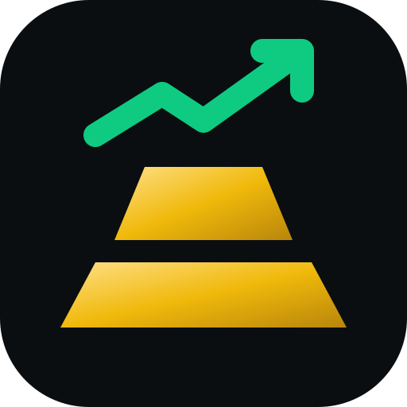
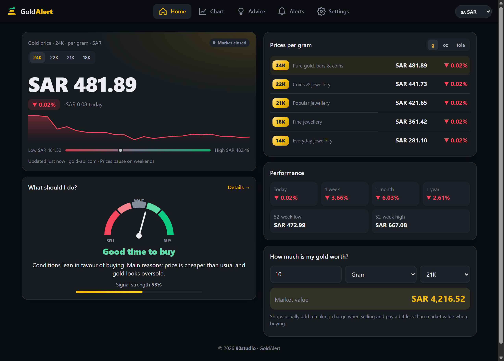
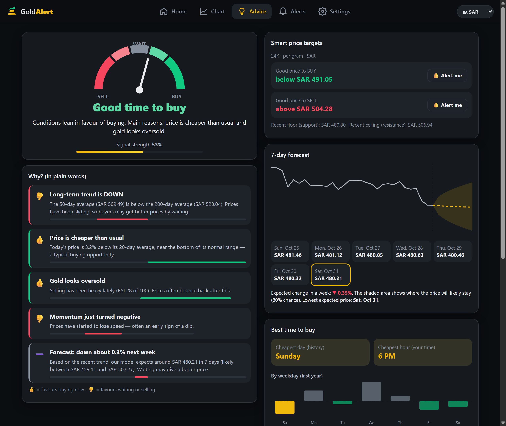
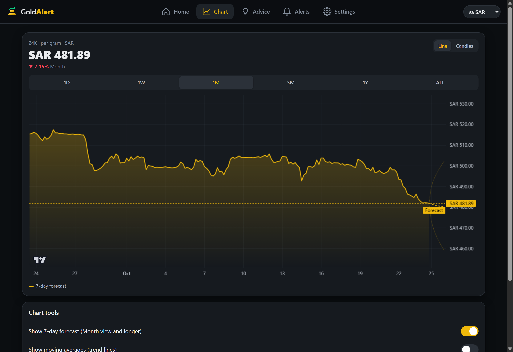
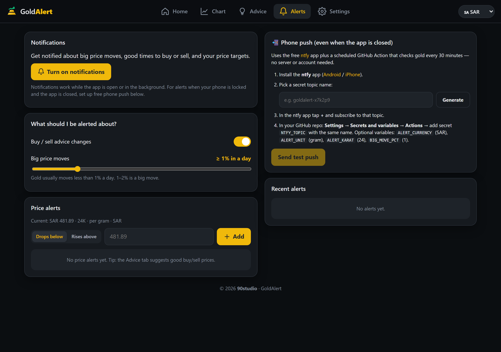
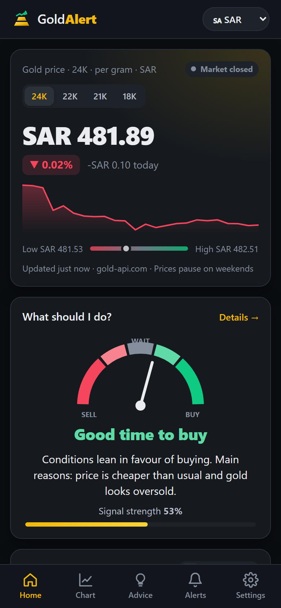

<div align="center">
  
  <h1>GoldAlert</h1>
  <p><strong>Live Gold Prices · Plain-English Buy/Sell Recommendations · 7-Day Forecast · Price Alerts</strong></p>
  <p>
    <a href="https://daoudz.github.io/GoldAlert/"><strong>🌐 Open Live Web & Mobile App (daoudz.github.io/GoldAlert)</strong></a>
  </p>
  <p>
    
    
    
    
    
    
  </p>
</div>

---

**GoldAlert (`v1.1.0`)** is a fast, portable **Progressive Web App (PWA)** built by **90studio** for everyday gold buyers, savers, and investors. It tracks live international gold prices in **27 currencies**, supports **4 languages (`English`, `العربية`, `Français`, `اردو`)** with full RTL layout support, converts across every **karat (`24K`, `22K`, `21K`, `18K`, `14K`)** and **weight unit (`Gram`, `Ounce`, `Tola`, `Kilogram`)**, predicts the **7-day price trend**, highlights the **best time to buy**, and sends notifications on big daily moves or when your target price is reached.

---

## 🌍 Supported Languages (`v1.1.0`)

| Language | Native Name | Direction | Coverage |
| :--- | :--- | :---: | :--- |
| 🇬🇧 **English** | `English` | LTR | Full UI, plain-language buy/sell advice, charts & notifications |
| 🇸🇦 **Arabic** | `العربية` | RTL | Full UI, Arabic technical analysis explanations, localized units & notifications |
| 🇫🇷 **French** | `Français` | LTR | Full UI, French technical analysis explanations, localized units & notifications |
| 🇵🇰 **Urdu** | `اردو` | RTL | Full UI, Urdu technical analysis explanations, localized units (`تولہ` / `گرام`) & notifications |

- **Auto-Detection:** Automatically selects your browser/device language on first visit.
- **Instant Switching:** Switch languages anytime from the top header pill (`🇬🇧 English`, `🇸🇦 العربية`, `🇫🇷 Français`, `🇵🇰 اردو`) or under **Settings → Display → Language**.

---

## 📸 Screenshots

### Desktop Dashboard & Buy/Sell Advice
| Home Dashboard (Live Prices & Calculator) | Plain-English Buy/Sell Advice & Forecast |
| :---: | :---: |
|  |  |

### Interactive Chart & Price Alerts
| Interactive Chart + 7-Day Forecast Band | Price Targets & 24/7 Phone Push Setup |
| :---: | :---: |
|  |  |

### Mobile App View (iOS & Android PWA)
<div align="center">
  
</div>

---

## 📖 Usage Guide (For Non-Professionals)

### 1. Check Live Gold Prices & Your Gold's Value (`Home` Tab)
1. **Pick your Language & Currency:** Use the language pill (`🇬🇧 English`, `🇸🇦 العربية`, `🇫🇷 Français`, `🇵🇰 اردو`) and currency pill (`🇺🇸 USD`, `🇪🇺 EUR`, `🇬🇧 GBP`, `🇸🇦 SAR`, `🇦🇪 AED`, `🇰🇼 KWD`, `🇪🇬 EGP`, `🇹🇷 TRY`, `🇮🇳 INR`, `🇵🇰 PKR`, and 17 more) in the top header.
2. **Switch Karat & Weight Unit:** Tap `24K`, `22K`, `21K`, or `18K` on the main price card, or switch between **Gram (`g`)**, **Ounce (`oz`)**, and **Tola** in the prices table.
3. **Calculate Your Gold's Worth:** Under **"How much is my gold worth?"**, enter the weight, unit, and karat of your jewellery, coin, or bar to see its instant market value.

### 2. Know Whether to Buy, Wait, or Sell (`Advice` Tab)
You don't need to read complex trading charts—open the **Advice** tab for a simple summary:
- **The Signal Gauge (`SELL` ↔ `WAIT` ↔ `BUY`):** Combines 5 market checks into a single recommendation (`Great time to buy`, `Good time to buy`, `Wait — no clear signal`, `Consider selling`, or `Good time to sell`) along with a **Signal Strength (%)** bar.
- **"Why? (in plain words)":** Explains each of the 5 factors with a simple 👍 (favours buying), 👎 (favours waiting/selling), or ➖ (neutral):
  1. **Long-Term Trend:** Compares the 50-day average against the 200-day average.
  2. **Normal Price Range:** Checks whether today's price is near the cheap bottom or expensive top of its 20-day Bollinger range.
  3. **Buying/Selling Pressure (RSI):** Detects when gold is oversold (bargain zone, `<30`) or overbought (`>70`).
  4. **Short-Term Momentum (MACD):** Spots when upward or downward momentum is accelerating.
  5. **7-Day Forecast:** Projects the next 7 days using damped Holt linear exponential smoothing with an **80% confidence band**.
- **Smart Price Targets:** Shows a suggested **Good price to BUY** and **Good price to SELL**—click **🔔 Alert me** next to either one to create a price alert in one tap.
- **Best Time to Buy:** Displays which **day of the week** and **hour of the day** (in your local time) have historically been cheapest over the past year, plus the lowest projected day in the upcoming 7-day forecast.

### 3. Explore the Interactive Chart (`Chart` Tab)
- Switch between **Line** and **Candles** and choose a timeframe: `1D` (Today), `1W` (Week), `1M` (Month), `3M` (3 Months), `1Y` (Year), or `ALL`.
- Use **Chart tools** to toggle:
  - **7-day forecast** (dashed gold projection line + 80% high/low range)
  - **Moving averages** (20-day and 50-day trend lines)
  - **Normal price range** (Bollinger bands)

### 4. Turn On Price & Signal Notifications (`Alerts` Tab)
- **Browser / Installed App Notifications:** Click **Turn on notifications** to receive alerts whenever:
  - The recommendation switches to **Buy** or **Sell**
  - Gold moves by more than your chosen daily percentage (e.g., `≥ 1% in a day`)
  - Gold crosses any of your custom **Drops below / Rises above** price targets
- **24/7 Phone Push (Even When the App is Closed):**
  1. Install the free **ntfy** app on [Android](https://play.google.com/store/apps/details?id=io.heckel.ntfy) or [iPhone](https://apps.apple.com/app/ntfy/id1625396347).
  2. In GoldAlert's **Alerts** tab, click **Generate** to create a secret topic name (e.g., `goldalert-x7k2p9`) and subscribe to that topic in the ntfy app.
  3. In your GitHub repository, open **Settings → Secrets and variables → Actions** and add a repository secret named `NTFY_TOPIC` with that topic name (and optional variables such as `ALERT_CURRENCY`, `ALERT_UNIT`, `ALERT_KARAT`, and `ALERT_LANG` set to `en`, `ar`, `fr`, or `ur`).
  4. The scheduled workflow [`.github/workflows/alerts.yml`](.github/workflows/alerts.yml) checks live gold prices every 30 minutes and pushes alerts straight to your phone.

---

## 📱 Install as a Mobile App (PWA)

- **Android (Chrome / Edge / Samsung Internet):** Open [https://daoudz.github.io/GoldAlert/](https://daoudz.github.io/GoldAlert/), go to the **Settings** tab, and tap **Install app** (or choose **Add to Home screen** from the browser menu).
- **iPhone / iPad (Safari):** Open [https://daoudz.github.io/GoldAlert/](https://daoudz.github.io/GoldAlert/) in Safari, tap the **Share** button, and select **Add to Home Screen**.

---

## 🛠️ Tech Stack & Local Development

- **UI:** [Preact](https://preactjs.com/) + [`@preact/signals`](https://github.com/preactjs/signals) + TypeScript + Vite
- **Charts:** TradingView [`lightweight-charts`](https://github.com/tradingview/lightweight-charts) + custom SVG gauges & forecast fans
- **Offline & Background Sync:** `vite-plugin-pwa` (Workbox `injectManifest` Service Worker + `idb-keyval`)
- **Live Data Sources (Keyless, CORS-Enabled, Auto-Fallback):** `gold-api.com` (XAU spot), `Binance` / `Coinbase` / `Kraken` (`PAXG` spot & OHLC candles), `open.er-api.com` & `frankfurter.app` (FX rates)

```bash
# Install dependencies
npm install

# Start local development server
npm run dev

# Run unit tests & typecheck
npm test
npm run typecheck

# Test live price + recommendation + alert engine in dry-run mode
npm run alerts:check

# Build production static bundle into dist/
npm run build
```

---

## 📄 Copyright & License

Copyright © 2026 **90studio**. All rights reserved.  
Released under the [MIT License](LICENSE).

> **Disclaimer:** GoldAlert is for informational and educational purposes only and does not constitute financial or investment advice.
